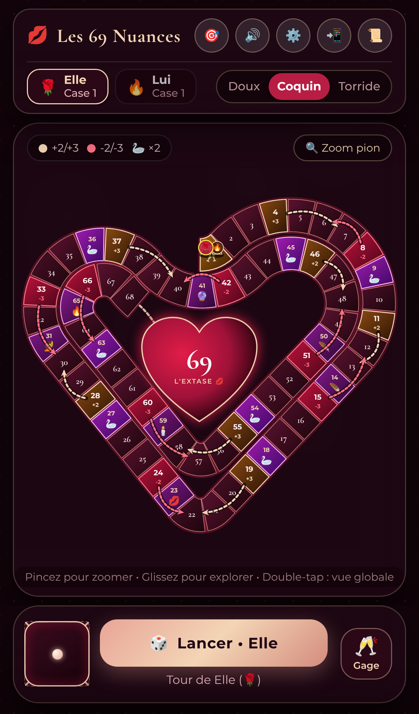

# Les 69 nuances du désir

Un jeu de l'oie coquin pour 2 à 4 joueurs, en une seule page web (`index.html`) installable sur iPhone et iPad. Le plateau en forme de cœur compte 69 cases ; chaque case propose un gage tiré de trois niveaux : **Doux**, **Coquin** et **Torride**.

**Jouer en ligne : https://sillageprod.github.io/les-69-nuances-du-desir/**
(lien de secours : https://les-69-nuances-du-desir.89y64z7b9g.workers.dev)

## Installer le jeu sur iPhone ou iPad

1. Ouvrez https://sillageprod.github.io/les-69-nuances-du-desir/ dans **Safari**.
2. Touchez le bouton **Partager** (carré avec une flèche vers le haut).
3. Choisissez **Sur l'écran d'accueil**, puis **Ajouter**.
4. Lancez le jeu depuis son icône : il s'ouvre en plein écran et fonctionne hors connexion.

## Les gages

Les gages sont gérés dans un Google Sheet, une feuille par niveau (Doux, Coquin, Torride) :
https://docs.google.com/spreadsheets/d/1J91y_WMOpqwWzjTwyDoTuoylCM_Imk4LD89ZhzM-q4M/edit

Colonnes : ID | Type de case | Libellé | Icône | Titre | Description | Minuteur (s) | Pour qui | Actif.

À l'ouverture, le jeu relit le Sheet s'il est partagé en « Toute personne disposant du lien ». Sinon, il utilise la copie intégrée. Une sauvegarde CSV de chaque feuille se trouve dans le dossier [`gages/`](gages/).

## Jouer sur l'Apple TV

L'Apple TV n'a pas de navigateur. Pour afficher le plateau sur la télé, utilisez la **recopie AirPlay** :

1. Mettez l'iPhone ou l'iPad et l'Apple TV sur le même réseau Wi-Fi.
2. Ouvrez le **Centre de contrôle** et touchez **Recopie de l'écran**.
3. Choisissez votre Apple TV, puis lancez le jeu.

## Contenu du dépôt

- `index.html` : le jeu complet (une seule page, sans dépendance externe)
- `gages/` : sauvegardes CSV des gages
- `apercus/` : captures d'écran

Contenu réservé aux adultes.
